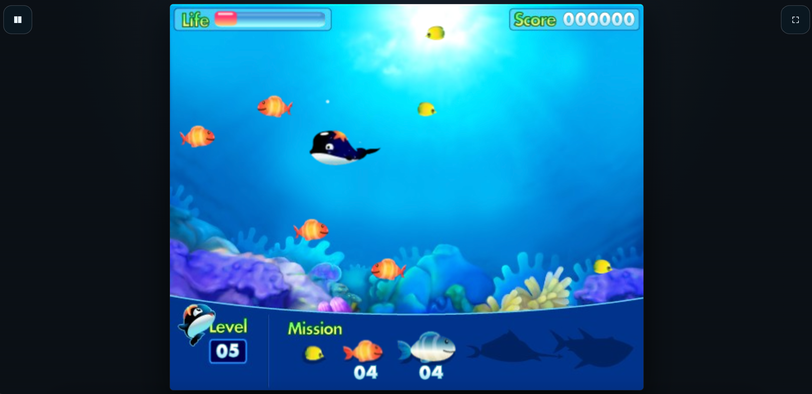
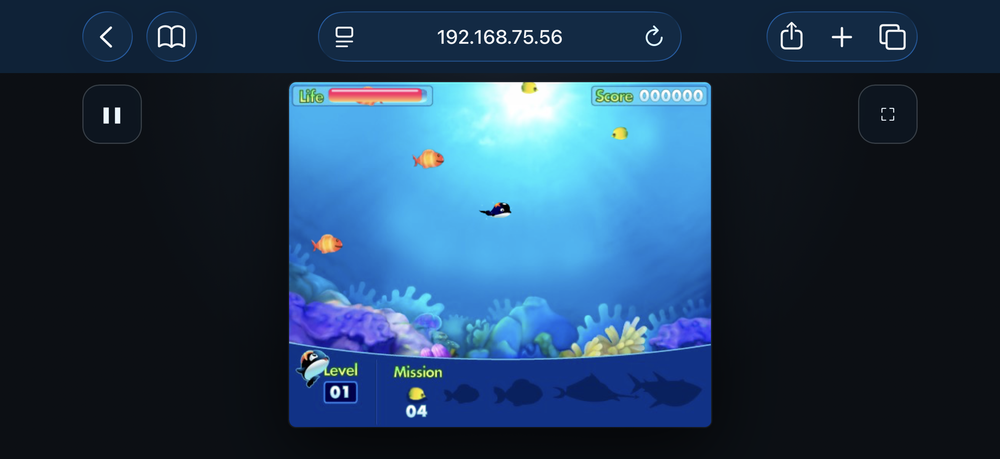

# Feed-Whale 喂食鲸

本项目 90% 为纯 Vibe Coding. 核心理念是把原 Flash 版本的 `.swf` 逆向得到资源后重新使用 TypeScript + HTML5 Canvas + Web Audio API 复刻出来，**行为上与原作逐帧一致**. 并且在原作基础上增补了暂停、设置、金手指等功能。同时适配了移动端, 支持 PWA

AI 使用 DeepSeek V4.1 Flash + ZCode.

在线体验:

- https://whale.limboer.top/
- https://whale-2qevp0.maozi.io/

原版 Flash 游戏: http://flash.ourgame.com/home/game/3025

## 游戏截图

<figure>
  
  <figcaption style="text-align: center;">网页桌面端</figcaption>
</figure>

<figure>
  
  <figcaption style="text-align: center;">手机移动端</figcaption>
</figure>

## 快速开始

```bash
cd game
npm install          # 已配好淘宝源（.npmrc）
npm run dev          # 开发服务器，见下
npm run build        # 产出纯静态站点到 game/dist
```

## 常用命令

```bash
# 重新导出全部素材（需要 tools/ffdec/ 与 PATH 里的 java）
tools/ff -export script,image,shape,sprite,button,font,sound,text,binaryData,frame re/export/Qua01 swf/Qua01.swf
tools/ff -format sprite:svg -export sprite re/tmp_svg swf/Qua01.swf

# 重建素材清单与工程索引
python3 tools/build_manifest.py re/tmp_svg re/export/Qua01/sprites re/manifest.json
python3 tools/prepare_assets.py

# 重新生成去混淆代码
python3 tools/avm1_cfg.py swf/Qua01.swf -o re/logs/Qua01_cfg.txt --stats
python3 tools/deflatten.py re/export/Qua01/scripts/frame_2/DoAction.as -o re/flat/frame_2.flat.as
```

`tools/ff` 是 ffdec 的包装脚本，负责把 keg-only 的 Homebrew OpenJDK 放进 `PATH`。

### 目录结构

> `swf/` 里的两个文件是这个项目唯一的原始素材来源，**请当作只读**：所有反编译和素材导出都从它们读起，`re/` 下的产物全部可由此重建。

```
feed-whale/
├── swf/                      # ★ 原始的 Qua01.swf / Qua_RES.swf，所有工具都读这里
├── ref/                      # 按 game/lang/Qua_RES.swf 相对路径摆好的副本（跑原版用）
├── tools/                    # 逆向与素材流水线（Python）
├── re/                       # 逆向产物
│   ├── REPORT.md             # ★ 逆向规格报告（1249 行，实现依据）
│   ├── export/               # ffdec 导出的脚本 / 精灵 / 位图 / 形状 / 音效
│   ├── flat/                 # 去混淆后的 ActionScript
│   ├── ref_frames/           # 原作根时间轴渲染帧（对照基准）
│   ├── compare/              # 其它版本/平台的 SWF（4399、韩版）对照用
│   └── logs/                 # 反汇编与标签转储
└── game/                     # Vite + TypeScript 复刻工程
    ├── index.html            # 画布 + 浮层根节点 + PWA meta
    ├── src/
    │   ├── main.ts           # 启动与接线
    │   ├── flash/            # Flash 兼容层（Clip 时间轴 / Stage / SoundMaster）
    │   ├── game/             # 游戏逻辑（constants.ts + Game.ts）
    │   ├── ui/overlays.ts    # 暂停菜单 / 设置面板
    │   ├── settings.ts       # 设置存储
    │   ├── platform.ts       # 输入、自适应缩放
    │   └── assets.ts         # 素材加载
    ├── public/assets/        # 从 SWF 导出的美术与音效（2.2MB，生成物，见「素材只留用得上的」）
    └── dist/                 # 构建产物（2.7MB）
```

### 移动端 / 触屏

触屏设备上有一个**虚拟摇杆，但平时不画出来**——手指按下屏幕时才在那一点淡入出现，跟着拖动，松手淡出；而且**按在屏幕任何位置都行**，包括游戏画面外的空白带。这样屏幕上没有任何常驻的控件元素，也不会有"这个圆圈该往哪儿按"的困惑：按哪儿，摇杆就在哪儿。

游戏画面在两种朝向下**同样处理**：居中，并且尽可能占满可用空间。

| 朝向          | 画布    | 占屏   | 摇杆       |
| ------------- | ------- | ------ | ---------- |
| 横屏 844×390  | 455×372 | 高 96% | 触点处淡入 |
| 竖屏 390×844  | 372×304 | 宽 96% | 触点处淡入 |
| 桌面 1280×720 | 858×702 | 高 98% | 无（键盘） |

#### 触摸区域是整个屏幕，不只是游戏画面

这点很重要：横屏时画布只有屏幕宽度的 54%（844 里占 455），而大拇指自然停留的位置恰恰是右边那条空白带。如果只把 `pointerdown` 绑在画布上，一半的屏幕会是死的——按下去既不出摇杆，也没法操作。

所以监听挂在 **window** 上，整屏都能唤起摇杆。唯一的例外是开场遮罩（`#gate`）：那是真的 DOM 按钮，在那里冒出摇杆只会碍事，所以显式跳过。

摇杆元素本身**不接受任何事件**（`pointer-events: none`），按下 / 拖动 / 抬手分别取自 window 的三个阶段，因此它出现在手指底下也不会把自己后续的事件抢走。`body` 上设了 `touch-action: pinch-zoom` 和 `overscroll-behavior: none`：单指拖动归摇杆，同时保留双指缩放，也避免下拉刷新打断操作。

#### 摇杆是「八方向数字」的，不是模拟量

这一点是刻意的。**原版游戏的输入就是 `Key.isDown(37/38/39/40)` 四个数字开关**，速度靠每帧 `xspeed += 1.5` 再 `× 0.9` 衰减累积出来，根本不存在模拟轴。所以摇杆按 8 个 45° 扇区解算成同样的四个布尔量——推到底和轻推是同一个速度，行为与键盘**逐位等价**：

| 推杆方向                 | 产生的输入                                          |
| ------------------------ | --------------------------------------------------- |
| 0° / 90° / 180° / 270°   | `right` / `down` / `left` / `up`                    |
| 45° / 135° / 225° / 315° | `right+down` / `down+left` / `left+up` / `right+up` |
| 中心 18% 半径内          | 无（死区）                                          |

这样做的好处是物理数值一个没动，之前逐项核对过的速度曲线（第 1 关稳态 13.5、第 5 关 8.5）依然成立。如果哪天想要真正的模拟量手感，那需要改 `Game.playerFrame()` 里那 4 行，会偏离原版，建议做成独立开关而不是默认行为。

实现上摇杆只是**一个往 `Input.virtual` 集合写方向的来源**，和键盘的 `held` 集合在 `sync()` 里合并。`Game.ts` / `Stage.ts` 完全不知道用的是键盘还是摇杆。

#### 调试用参数

`?touch=1` 可以在桌面浏览器上强制显示摇杆，方便预览移动布局：

```bash
open "http://localhost:5173/?touch=1"
```

没有触屏的设备本来就不创建摇杆，`#controls` 浮层保持 `display: none`，桌面布局完全不受影响。画布外没有任何文字：玩法说明在设置面板的「关于」tab 里，早先那行「本地最高分 N」已经去掉（连最高分机制本身也移除了，见「本地最高分已经移除」）。

#### 全屏与「添加到主屏幕」

游戏画面在手机上能占多大，取决于浏览器工具栏吃掉了多少高度——横屏时画布高度就等于 `innerHeight − 16`，所以工具栏那几十像素直接是画布的高度。两个平台的路子不一样：

| 平台           | 做法                                          | 效果                                                              |
| -------------- | --------------------------------------------- | ----------------------------------------------------------------- |
| Android Chrome | **右上角的 ⛶ 按钮**，调 `requestFullscreen()` | 直接进全屏，没有地址栏                                            |
| iPhone Safari  | 用户 **「添加到主屏幕」** 后从图标启动        | 独立窗口（manifest 里 `display: "standalone"`），无 Safari 工具栏 |

需要说清楚的：**iPhone 上这件事没有代码能强制**。Safari 至今不实现 `Element.requestFullscreen()`，唯一的路是 PWA 独立窗口，而那要用户自己点「添加到主屏幕」。所以「全屏」按钮只在支持该 API 的浏览器上出现，iPhone 上不显示，免得变成一个点了没反应的按钮。

「添加到主屏幕」在 iOS 上会用到这些配置，都已经在 `index.html` 里：

```html
<link rel="manifest" href="./manifest.webmanifest" />
<link rel="apple-touch-icon" href="./icons/apple-touch-icon.png" />
<meta name="apple-mobile-web-app-capable" content="yes" />
<meta name="apple-mobile-web-app-status-bar-style" content="black-translucent" />
```

图标是直接拿游戏自己的美术生成的（海面背景 + 长大的鲸鱼），在 `public/icons/`：192/512 普通图标、512 maskable、180 apple-touch-icon。

#### 安全区适配

`viewport-fit=cover` 加 `main` 上的 `env(safe-area-inset-*)` 内边距，让内容避开刘海、home 指示条和圆角。关键是 `View.fit()` **不假设边距是 8px，而是把 `main` 的计算样式读回来**——所以这些内边距会自动被算进画布的可用空间，将来调边距不用同步改 JS。摇杆自己的右下角定位也用同一套 `env()`。

玩法：**方向键**（或 WASD）移动，吃掉比自己小的鱼；碰到大鱼扣血，碰到鲨鱼几乎致命。饥饿条（左上 "Life"）见底就结束。底部 4 个 Mission 计数清零即升级，鲸鱼会长大，第 8 关开始出现鲨鱼。养到第 10 关通关。

---

## 原作没有的部分：暂停 / 设置 / 金手指

这三块是增补，原版 SWF 里没有。它们的设计前提是**默认状态下的游戏行为逐帧不变**——所有金手指默认关闭，不碰暂停键的话游戏和原作完全一致。

### 进入游戏的流程

打开页面 → 正中间显示「载入中…」→ 素材就绪后直接进入**游戏自己的标题画面**（那只是原作 root 时间轴的第 1 帧，带有原作画在画面里的「开始游戏 / 游戏说明」两个按钮）。

这里没有宿主提供的开始弹窗——早先版本有过一个，后来去掉了，因为那个弹窗和随后的原作标题页其实是两个入口，点完弹窗才看到真正的标题画面，多一层反而别扭。

右上角常驻一个 ⛶ 全屏按钮；左上角是**语境按钮**：标题页和结算页是 ⚙ 设置，游戏进行中是 ❚❚ 暂停。所以设置在任何状态下都只差一次点击，游戏中则交给暂停菜单。

### 暂停

游戏进行中左上角有一个暂停按钮（视口角落，不是画布角落——画布左上角是 Life）。52×52，落在画布外的空白带里，不遮 HUD。点它或按 `P` / `Esc` 打开暂停菜单：

- **继续** / **重新开始** / **设置** / **返回主菜单**
- 切到后台或窗口失焦会**自动暂停**，接个电话回来不会发现鲸鱼已经饿死

暂停是真的停：`Stage.paused` 让帧循环只绘制、不推进逻辑（不是 `Stage.stop()`，那会连绘制一起停掉，浮层的毛玻璃就没东西可盖了）。实测暂停 2.5 秒后 tick 增量为 0、饥饿值、鱼的位置、动画帧全部逐位相同。音频走 `AudioContext.suspend()`，从暂停点续播而不是重头开始。

### 设置

两个入口，同一块面板：**标题页左上角的 ⚙ 按钮**，以及暂停菜单里的「设置」。分三个 tab：

| tab        | 内容                                              |
| ---------- | ------------------------------------------------- |
| **基本**   | 声音（背景音乐 / 游戏音效）、操作（显示虚拟摇杆） |
| **金手指** | 无敌 / 永久隐身 / 饥饿不减 / 吃任何鱼 / 跳到关卡  |
| **关于**   | 玩法说明与操作方式（纯文字，没有开关）            |

tab 用的是标准语义：`role="tablist"` / `role="tab"` / `role="tabpanel"`，`aria-selected` 与 `tabindex` 同步，左右方向键在两者间切换并把焦点带过去（同时拦掉事件，免得方向键顺带被游戏当成移动键）。

面板里只有设置本身，没有「重置」类操作。早先放过「重置最高分」和「恢复默认设置」两个常驻按钮，跟着最高分一起删掉了——要回到出厂状态就逐项拨回去，或者在浏览器里清掉本站的 localStorage。

手机横屏时面板高度会被视口夹住（842×388 下只有 364px）。所以动作区做成了 sticky 常驻底部——不能出现"关闭按钮要滚动才够得着"这种事。桌面和竖屏下两个 tab 都无需滚动。

全部存 localStorage。开关用的是真的 `<input type="checkbox">` 做样式化，不是 div 伪装的——所以键盘能 Tab、空格能切、屏幕阅读器能读。点浮层外的暗色区域会退一层（横屏手机上够不到按钮时很方便）。

「重新开始」「返回主菜单」都走**行内二次确认**：点一下按钮变成「确认…？」并变红，3 秒内再点才执行，期间点别处取消。没用 `window.confirm`——那个在移动端是浏览器原生弹窗，和整个界面完全两个世界。

### 金手指

| 开关            | 效果                                                                                                             |
| --------------- | ---------------------------------------------------------------------------------------------------------------- |
| 无敌            | 撞大鱼和鲨鱼都不掉血（震屏和受伤动画也跳过）                                                                     |
| 永久隐身        | 常驻道具效果：alpha 40、免伤，**并且鲨鱼不会追你**——这是原作隐身本来就带的副作用，所以这个开关也改变了鲨鱼的行为 |
| 饥饿不减        | 饥饿条不再下降，等于无限时间                                                                                     |
| 吃任何鱼        | 无视体型限制，连鲨鱼也能吃                                                                                       |
| 跳到关卡 [1~10] | 同时是下一局的起始关卡                                                                                           |

**「跳到关卡」和「升级到某个等级」是同一个操作**——这游戏里「第几关」和「鲸鱼多大」是同一个数（`getLevel()` 直接返回 `player_mc._currentframe`）。所以一个步进器就够，跳完鲸鱼体型、Level 数字、四个任务计数、可食提示图标会一起同步。

### 交互上值得一提的几处

- **摇杆在浮层打开时完全禁用**。摇杆监听的是整个 window，不处理的话在设置面板上划一下就会给鲸鱼攒上速度，一恢复就窜出去。
- **`Esc` 由浮层独占**。主逻辑和浮层都监听 keydown，而 `document` 上的监听器在冒泡时先于 `window` 执行——不阻止冒泡的话，浮层关掉菜单后主逻辑会看到"菜单已关闭"，于是把同一个按键解释成"打开菜单"，`Esc` 就永远关不掉任何东西了。
- **打开任意浮层都会停表**。
- 打开浮层时焦点移到第一个控件，关闭时还给暂停按钮。

## 逆向是怎么做的

### 1. 文件里到底是什么

两个都是 `CWS`（zlib 压缩）SWF v7，也就是 **ActionScript 2 / AVM1**：

|        | Qua01.swf（游戏）                                                         | Qua_RES.swf（界面资源）                 |
| ------ | ------------------------------------------------------------------------- | --------------------------------------- |
| 解压后 | 560,052 字节                                                              | 178,373 字节                            |
| 舞台   | 550×450 @ 30fps，主时间轴 2 帧                                            | 550×450 @ 30fps，1 帧                   |
| 内容   | 52 精灵 / 87 矢量形状 / 14 段 MP3 / 62 张带 alpha 的 JPEG / 16 张无损位图 | 9 形状 / 5 按钮 / 8 精灵 / 内嵌 Verdana |

游戏用 9 个 `ImportAssets` 标签从相对路径 `game/lang/Qua_RES.swf` 取界面素材（开场图、帮助图、结算卡、按钮）。

### 2. 代码被混淆了

`Qua01` 的脚本过了一遍 AS2 混淆器，有三层：

1. **控制流扁平化** —— 每个 action 流被改写成 `while(true){ if(pc == K){ pc = K±D; <真代码> } }` 形式的状态机，真正的语句原封不动躺在 `<真代码>` 里，只是被拆成了一堆基本块。
2. **标识符重命名** —— 局部变量、成员名、辅助函数被换成随机二进制字符串（常量池里那些 `ae60c1`、`ad58` 之类的高熵条目）。**这些名字不是加密的，只是没有意义**，同一个字节串永远指同一个东西，用 ffdec 导出时会显示成 `«ae60c1»`。
3. **死字节填充** —— `Jump +2` 跳过的两字节会让线性反汇编器在 `0xc9` 处错位。

`tools/` 里为此写了两个工具：

- **`avm1_cfg.py`** —— 按控制流图反汇编（跟随 Jump/If 目标，把不可达的字节当装饰忽略），并沿途解析内联的 `ActionConstantPool`。线性扫描会错位，这个是能跑通的关键。
- **`deflatten.py`** —— 递归展开 `else { if(...) ... }` 嵌套的分发链，把每个基本块的真代码按状态编号列出来。

配合 `tools/build_manifest.py`（从 ffdec 的 SVG 帧导出里读精灵原点偏移）和 `tools/prepare_assets.py`（把素材拷进工程并生成索引）。

### 3. 非标准标签 0xFD

Qua01 里有 16 个 **非标准标签 253**，每个都紧贴在 `DoAction`/`DoInitAction` 前面，内容是高熵前缀 + 可读的类成员名 + 字节码。ffdec 也认不出来（`Unknown (tid: 253)`）。

结论：**Flash 会直接忽略未知标签，所以它们不参与游戏运行**，是混淆器塞进去的干扰数据。真正执行的是标准的 `DoAction`/`DoInitAction`。这一点由"复刻版按标准标签实现后行为与原作一致"反向验证。

### 4. 关于「联机玩法」

原始文件里**没有任何实时联机代码**。服务器相关的只有分数上传 + 排行榜：`ServerConnection` 类，`getRankEnabled()` / `onGameRankRequest()` 钩子，以及 Qua_RES 里那套多平台框架常量池（`kr_hangame` / `cn_ourgame` / `jp_hangame` 等六种 serviceType 对应五个 CDN 域名）。原版是**主机页面**负责加载这个框架并接管排行榜按钮，SWF 里的 `rank_btn` 根本没被放置。

所以单机版覆盖了原作除「上传分数到联众服务器」之外的全部功能。那一块——排行榜、最高分——复刻版不做任何记录，分数只在本局界面里出现。

### 5. 水域边界是一个遮罩，不是一条隐藏规则

游戏画面里任务栏上方那条曲线不是美术效果，而是**玩法边界**。原作在 depth 9 放了一个形状 90，并在 `PlaceObject2` 上设了 `clipDepth = 73`：

```
PlaceObject2 (chid: 90, dpt: 9, cdp: 73)
```

这会把 depth 10~73 画出的一切裁进形状 90 的轮廓里——正好是 `player_mc`(10)、`levelup_mc`(54)、`boggle_mc`(69)、`fish_area`(71)。形状本身是一条带二次贝塞尔的路径：

```
M 550 -1  L 550 340  Q 265.05 380.7  0 338  L 0 -1  Z
```

也就是底边中间下凹到 y=380.7、两侧收回到 y=338 的水域轮廓。HUD（depth 91+）和结算卡（74/77）在遮罩之上，不受影响。复刻版直接拿这个路径建了个 `Path2D` 做 `ctx.clip()`。

### 6. 没有可提取的文本

UTF-8 / GBK / UTF-16 / Big5 / EUC-KR 全扫过，两个文件里**一个中文字符都没有**。界面文字（标题、按钮、结算卡文案）是**直接画在位图里**的——这也是为什么复刻版的界面天然就是原版的中文。副作用是无法改文案、无法重新本地化。

### 7. 素材只留用得上的

ffdec 导出的是整个资源库，而移植版只碰其中一部分。为了知道差多少，我把 `CanvasRenderingContext2D.drawImage` 打了桩记录每一张真正落到画布上的图，然后手动逐帧驱动（`stage.step()` / `render()`，见 AGENTS.md 里关于 rAF 节流那条）走完所有状态：开场页、游戏说明、1~10 级鲸鱼、全部鱼种与鲨鱼、道具、升级、结算卡、通关卡。结论是 **3.58MB 里只有 2.13MB 会被画到**：

| 从没用到的东西                                                                                                                                                       | 体积  |
| -------------------------------------------------------------------------------------------------------------------------------------------------------------------- | ----- |
| 17 个 sprite 目录（141 张 PNG），如 `DefineSprite_6`（639KB）、`204`（鲸鱼那 10 张静态成长图，实际画的是 `whaleAni` 那 10 套）、`215`（结算卡，已改用 RES 真图重建） | 813KB |
| `images/` 79 张里的 76 张——它们都是"构成某个精灵的碎图"，而导出时精灵已经被烤成了完整帧，等于存了两遍                                                                | 611KB |
| 按钮悬停态 `2_over`、排行按钮图、`3_down`/`4_hittest`、3 个从没播过的音效                                                                                            | 64KB  |

修剪发生在 `tools/prepare_assets.py` 里——它的 `KEEP_*` 白名单就是上面这套结论的固化，重跑即可复现。素材文件数从 565 降到 325，冷启动少发 240 个请求、少下载 1.45MB。

另有两条路试探过但**放弃**了，记在这里免得后人重走：

- **按 alpha 外接矩形裁边**：不少帧画布利用率很低（吃鱼提示只占 32% 面积、饥饿条 22%），裁掉透明边能再省约 240KB，但 `FrameArt.w/h` 不只是绘制尺寸——`Game.ts:1332` 拿 `a.w / 2` 做点击命中判定、`1361` 拿 `a.w / 551` 算按钮缩放。裁边会改这两个值，等于动了玩法，所以不做。
- **转 PNG-8 调色板**：只有颜色数 ≤256 才能无损。实际数下来，升级火花（≤150 色）和饥饿条（≤94 色）能转，合计省不到 30KB；最大的通关卡 `DefineSprite_221`（883KB，占素材四成）平均 1.75 万色，转调色板只能是有损的。

通关卡那 883KB 是现在素材里最大的一块，它是 10 张 551×451 的整屏 PNG，在 0.3 秒的展开动画里各显示一帧。真要继续瘦身只能动它的美术，那就不是"删减"而是重做了。

---

## 复刻版怎么保证「一模一样」

- **美术不重画**：ffdec 把每个精灵按各自时间轴逐帧渲染导出成 PNG，直接 blit。每个 PNG 还带精灵注册点在画布中的偏移（从 SVG 导出里读出来的），所以摆放位置和 Flash 当年一致。

  两个地方例外：结算卡（sprite 215）和帮助面板（sprite 64）的**面**是 `ImportAssets` 引进来的位图，ffdec 导出时会画成一块纯红占位符。这两处改成直接用 Qua_RES 里的真图（`@gameover02`、`@howto`），配上从报告里还原的展开动画重建。

  还有一个坑：`enemy` 精灵的第 2~4 帧（以及 `shark`）**导出帧里已经烤进了游动循环的第一帧**。所以这两类鱼不能既用合成帧又挂一个动画子精灵——那样会画出两条鱼。复刻版的做法是鱼身不画自己的位图（`Clip.skipOwnArt`），只按记录偏移（`FISH_ANI_OFFSET` / `SHARK_ANI_OFFSET`）挂动画精灵，帧数据仍保留以便 `_currentframe` 和包围盒继续工作。

- **逻辑不重写**：`game/src/game/Game.ts` 里的每个函数都是 `frame_2/DoAction.as` 的逐句转写，注释里标了 REPORT.md 的章节号。数值全部照抄常量表，没有半点手感调整：

```as
SPEED_LEVEL  = [0.9, 0.9, 0.88, 0.86, 0.85, 0.85, 0.85, 0.84, 0.83, 0.82]
EAT_LEVEL    = [1, 1, 2, 2, 3, 3, 3, 4, 4, 4]
NEXT_LEVEL   = [[0,0,3,3,4,4,5,6,6,7], [4,5,3,4,4,5,5,6,7,8]]
HUNGRY_LEVEL = [1.5, 2, 3, 5, 7, 9, 11, 13, 15, 17]
HUNGRY_UP    = [4, 8, 12, 16]        SCORE_UP    = [100, 150, 250, 300]
DAMAGE_LEVEL = [16,16,8,9,10,11,13,15,17,20]
Fish.highSpeed  = [3, 6, 4, 9, 7]    Fish.lowSpeed  = [0.5, 2, 0.5, 4, 4]
Fish.highRate   = [0.2,0.5,0.2,0.2,0.8]  Fish.changeRate = [0.5,0.5,0.3,0.8,0.7]
```

- **节奏不飘**：30fps 固定步进（`Stage.step`），不用 `requestAnimationFrame` 的浮动 delta。
- **不套游戏引擎**：这游戏的碰撞是自定义 `hitTest`（轴对齐包围盒）、动画是 Flash 时间轴、补间是 `mx.transitions.Tween`。自己写个薄薄的兼容层（`src/flash/`）比跟 Phaser 的动画/输入模型打架更直接。

### 已验证一致的部分

| 项目               | 结果                                                                                                                                                                                                |
| ------------------ | --------------------------------------------------------------------------------------------------------------------------------------------------------------------------------------------------- |
| 舞台 / 缩放 / 背景 | 550×450 @ 30fps，与 `ref_frames/2.png` 逐像素对齐                                                                                                                                                   |
| HUD 布局           | Life 条、Score 六位、Level、四个 Mission 计数位置全部一致                                                                                                                                           |
| 鲸鱼成长           | 美术宽度 55 → 99 → 153px（1 级 / 5 级 / 10 级）                                                                                                                                                     |
| 任务表             | L5 = `[0,4,4,0]`，L10 = `[0,0,7,8]`，与 `NEXT_LEVEL` 推导值逐项吻合                                                                                                                                 |
| 吃鱼               | `+100` 分、任务计数递减、饥饿 `+4`                                                                                                                                                                  |
| 移动手感           | 无摩擦加速 + 每帧 ×`SPEED_LEVEL` 衰减，边界钳制在 `IV.TOP/BOTTOM/LEFT/RIGHT`                                                                                                                        |
| 饥饿               | 每帧扣除 `HUNGRY_LEVEL[level-1]/60`，`hungry < 0`（严格小于）才结算                                                                                                                                 |
| 受伤               | 撞大鱼按 `DAMAGE_LEVEL` 扣血 + 5 次震屏；鲨鱼扣 `HUNGRY_SHARK` = 100 + 10 次震屏                                                                                                                    |
| 鲨鱼               | 8 关起出现，场上最多 3 条，120×90 范围内开始直线追击                                                                                                                                                |
| 道具               | 5 关起投放，从右边缘以 3px/帧左移（原版 `it.onEnterFrame` 的 `this._x -= 3`），拾取后 `ITEM_TRANS` 隐身 5 秒并免疫伤害                                                                              |
| 帮助面板           | sprite 64 的面同样来自导入位图 `@howto`，ffdec 只能渲染成红色占位符。复刻版用 RES 里的真图重建，并复现了"20% 放大到 100% + 轻微回弹"的展开动画（f1-5 放大平移，f5-8 抖动，f9 停住）                 |
| 水域裁剪           | 原作在 depth 9 放了一个 `clipDepth = 73` 的遮罩（形状 90），把 depth 10~73 的鲸鱼、鱼群、气泡、升级特效都裁在水域内。复刻版用同一个路径 (`WATER_MASK`) 走 Canvas `clip()`，鱼游到任务栏下方会被隐藏 |
| 结算 / 重开        | Game Over 卡牌动画停在末帧，两个按钮居中可点（中文「重新开始 / 回主菜单」）。变暗底板是形状 209，`fill-opacity="0.3019608"`，即 30% 的黑，实测背景亮度降到 70%                                      |
| 通关 / 回主菜单    | All Clear 卡牌同样停在末帧，右下有「回主菜单」按钮。这个按钮在原版是 `ImportAssets` 引进来的符号，ffdec 导出帧时被跳过，卡牌本身的 `stop()` 也是精灵内部脚本、不在帧数据里，两处都补上了            |
| 通关               | 第 10 关任务清零触发 All Clear 卡牌                                                                                                                                                                 |

---

## 已知差异与取舍

| 项                   | 说明                                                                                                                                                                                                                                                                                                                                                                                                                                    |
| -------------------- | --------------------------------------------------------------------------------------------------------------------------------------------------------------------------------------------------------------------------------------------------------------------------------------------------------------------------------------------------------------------------------------------------------------------------------------- |
| 碰撞盒               | 用原作的共享 `hitArea` 精灵（63×123 椭圆）按各等级的 `_xscale/_yscale` 缩放，位置用报告里记录的偏移。和原作同一套参数，但没有逐帧复现 `hitTest` 的内部实现。                                                                                                                                                                                                                                                                            |
| 恒定帧率             | 原作锁 30fps。后台标签页切回来时最多补 5 帧，不会快进。                                                                                                                                                                                                                                                                                                                                                                                 |
| 暂停 / 设置 / 金手指 | **增补，不是复刻**。原版没有这些；默认全关时游戏行为不变。详见上一节。                                                                                                                                                                                                                                                                                                                                                                  |
| 分数不留档           | **刻意删除**。原作的排行榜靠主机页面里的框架组件，SWF 自身没有可用的实现；复刻版曾用 localStorage 记本地最高分，后来整个撤掉了。现在分数只存在于本局的 HUD 和结算卡上，不写任何存储。                                                                                                                                                                                                                                                   |
| 开场页的联众标志     | **刻意删除**。原版开场页底部有一条 sprite 21，上半是「联众游戏」标志，下半是联众框架里「域名校验跳转组件」**自带的使用说明文档**（"Redirecting Component / usage: put this component in the Copyright symbol…"）——原作者把组件拖到舞台上时没注意它会把自己的说明画出来，就这么发布了。复刻版整条移除。顺带修正：导出时取的第 1 帧是那份长文档，而原版因 `enabled=false` 走的是第 2 帧（"Redirecting is disabled…"），两者都是调试文本。 |
| 道具回收             | 原版道具的回收判定写反了（左移之后才判断 `this._x > IV.RIGHT`），所以永不触发，道具会一直飘出左边界留在 `eList` 里。复刻版**照抄了这个行为**，没有"修好"它。                                                                                                                                                                                                                                                                            |
| 帧循环容错           | 原版没有对应概念。复刻版在帧循环里捕获异常，单帧出错不会让整个游戏冻在黑屏上。                                                                                                                                                                                                                                                                                                                                                          |
| 音效实现             | Web Audio 重放 MP3；`SoundMaster` 的 `start(index, offset, loops)` 语义按 AS2 的「循环次数」还原。                                                                                                                                                                                                                                                                                                                                      |
| 开场音乐             | 原作 frame-1 脚本 `attachSound` 了一个不存在的 linkage id（`introbgm`），所以原版开场本来就是**静音**的——复刻版保持一致。                                                                                                                                                                                                                                                                                                               |
| `aqua_mc`            | depth 131 上一个 551×300 的黑矩形，用来算 `IV.TOP/BOTTOM/LEFT/RIGHT` 边界。复刻版把这四个值直接写成常量，不画它。                                                                                                                                                                                                                                                                                                                       |
| HUD 层级             | 任务栏 / Life / Score 在 SWF 里位于 depth 91~127，都在遮罩范围（≤73）之上，所以它们不会被裁；复刻版的绘制顺序与之一致。                                                                                                                                                                                                                                                                                                                 |

---

## 原作对照基准

想跑原版会撞上 `ImportAssets` 的限制：`Qua01.swf` 的界面素材来自 `game/lang/Qua_RES.swf`，而 Flash 只在**同一个播放器实例**里解析这类导入，所以不能简单地先后打开两个文件。

为此生成了一个加载器 SWF（`tools/make_loader_swf.py`），用 `loadMovieNum` 把两者叠进 `_level1` / `_level2`——`ref/` 目录就是按这个布局摆好的：

```
ref/
├── Qua01.swf
└── game/lang/Qua_RES.swf
```

**但 Ruffle 0.7.1 不渲染这样载入的关卡**（只出背景色），所以对照页没有随工程发布。想要真正跑原版，用支持 `loadMovieNum` 的 Flash Player / 较新的 Ruffle，按上面布局摆放后打开 `ref/Qua01.swf` 即可。

比对基准改用了更可靠的办法：**让 ffdec 直接渲染原作的根时间轴帧**——`re/ref_frames/1.png`（开场）和 `2.png`（游戏画面）。第 2 帧不依赖任何导入资源，可以完整看出 HUD 布局。复刻版的 HUD 就是照着它对齐的。

---

## 版权

美术、音效、界面文案均来自原游戏（NHN / Hangame，中文本地化由联众世界发行）。本复刻仅适合**个人怀旧与学习用途**，请勿商用或再分发。
